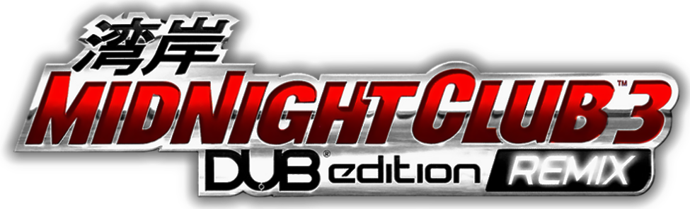

<p align="center"></p>

# Midnight Club 3 in the browser

A fan project that runs the Xbox racing game *Midnight Club 3: DUB Edition Remix* (2005) in Google Chrome. The game's
x86 code is translated to C ahead of time ([xboxrecomp](https://github.com/sp00nznet/xboxrecomp)) and compiled to
WebAssembly with Emscripten. Direct3D runs on WebGPU (WebGL 2 as a fallback) and the sound on Web Audio. You bring your
own disc.

> Not affiliated with or endorsed by Rockstar Games, Take-Two Interactive or Microsoft. This repository contains none
> of the game's code or data.

## Features

- **WebGPU renderer** by default, about 30 fps in cruise; WebGL 2 where WebGPU is missing.
- **Optional 60 fps** races and cruise (Settings, "60 fps races and cruise"; needs WebGPU to hold it).
- **System Link over a virtual LAN:** everyone on the same server meets as if on one local network. The bundled Rust
  server (`web/server`) carries it.
- **Saves in the browser** (OPFS), with import of Xbox profiles.
- **Keyboard and gamepads** (Gamepad API, up to four).
- **Settings page** for the renderer, resolution, filtering, language and more.
- Planned: free roam online for everyone on one server.

## What you need

- **The game:** your own Xbox disc of *Midnight Club 3: DUB Edition Remix* (Europe or USA), as files or as an ISO.
  The build accepts only the retail `default.xbe` files it knows, checked by size and hash
  (`config/remix/xbe_editions.h`). The DUB Edition (`GAME=dub`) is also supported by the build, at an earlier stage.
- **To build:** Linux, or Windows with WSL 2 (clone in the Linux file system, not under `/mnt/c`), with Python 3,
  CMake, Ninja, the [Emscripten SDK](https://emscripten.org/docs/getting_started/downloads.html) and, for the server,
  Rust 1.85 or newer.
- **To play:** the latest Google Chrome. Other browsers are untested.

## Build

```sh
git clone https://github.com/LeandroDettmer/mc3-web.git
cd mc3-web
make setup                                        # Ubuntu / WSL: build packages and the Python venv
source ~/emsdk/emsdk_env.sh                       # Emscripten on the PATH (or EMSDK=<dir>; default /opt/emsdk)
make extract GAME=remix ISO=~/discs/mc3-remix.iso # unpacks into game-remix/ (or copy the disc's files there)
make lift GAME=remix                              # translates the code to C, once: 10 to 20 minutes
make web GAME=remix                               # the browser build, into work-remix/build-web
```

`tools/build_web.sh` builds into a folder of your own. The generated C and the build are made from your disc, so they
are never committed, and the disc is never copied into the build: it is read from your folder over HTTP.

## Play

Quick, with the dev server:

```sh
make web-serve GAME=remix        # http://localhost:3000/ (PORT=, BIND= change that)
```

Or with the Rust server, which also carries System Link:

```sh
cd web/server && cargo build --release
target/release/mc3-server --web .. --build ../../work-remix/build-web \
    --disc ../../game-remix --port 3000
```

`--web`, `--build` and `--disc` repeat; `--bind 0.0.0.0` serves other PCs (localhost by default). See
[web/server/README.md](web/server/README.md).

Open **http://localhost:3000/** in Chrome and press **Play**. The player's guide is
[docs/web/PLAYING.md](docs/web/PLAYING.md).

## Controls

The keyboard is pad 1, laid out like the Xbox pad. Arrow keys steer, gas and brake; Space is the handbrake; Enter is
Start. A, B, X, Y are the face buttons; I/J/K/L the d-pad; Q/E White and Black; T/F/G/H the right stick. The page's
**Controls** tab and [docs/web/PLAYING.md](docs/web/PLAYING.md) have the full map. Gamepads work as pads 1 to 4.

## Online

System Link is the game's own multiplayer over a local network. On the web, the server's `/lan` WebSocket switch is
that network: players on the same server get virtual addresses and find each other in the game's System Link menu.
Switch it on in the start page's **Online** tab (Remix). To play with friends on other PCs, serve the page over HTTPS.
Free roam for everyone on one server is planned.

## Contributing

The development loop (lift, build, test), the project layout and an optional native Linux build for debugging with
gdb and difftest are in [CONTRIBUTING.md](CONTRIBUTING.md). This repository is about the browser port: the macOS,
Windows and Nintendo Switch hosts of mcdub3-nx are not maintained here.

## How it works

- **`tools/`:** a Python lifter turns every function of `default.xbe` into C.
- **`xboxrecomp/`:** the toolkit: Xbox kernel, Direct3D on OpenGL and WebGPU, audio, XNet.
- **`src/`:** this game's glue: boot, file system, overrides.
- **`web/`:** the start page and its scripts; **`web/server/`:** the Rust server.
- Decisions: [docs/decisions/](docs/decisions/). Developer notes: [CONTRIBUTING.md](CONTRIBUTING.md), [CLAUDE.md](CLAUDE.md).

## Credits

Based on [mcdub3-nx](https://github.com/laureladastra/mcdub3-nx) by Laure Ladastra (MIT) and the
[xboxrecomp](https://github.com/sp00nznet/xboxrecomp) toolkit. The WebGPU renderer, the server and the networking
build on ideas and code from [nfsu2-web](https://github.com/th0mk/nfsu2-web) by th0mk (MIT). Full list and third-party
licences: [NOTICE.md](NOTICE.md).

## License

mc3-web's own code is under the GNU AGPL-3.0 ([LICENSE](LICENSE)), plus one extra term. If you ship or host a copy,
modified or not, you must show "Based on mc3-web by Leandro Dettmer" with a link to this repository where its users can
see it. If you host a modified copy, you must also publish its source. The terms are in
[NOTICE.md](NOTICE.md#additional-terms-agpl-30-section-7). The code from mcdub3-nx (Laure Ladastra) stays MIT
([LICENSES/MIT.txt](LICENSES/MIT.txt)). The vendored toolkit in `xboxrecomp/` is MIT too, with LGPL-2.1 parts extracted
from xemu (see [NOTICE.md](NOTICE.md)). This repository contains no game code or data.

## Legal

*Midnight Club* is a trademark of Take-Two Interactive / Rockstar Games. Xbox is a trademark of Microsoft. This is an
unofficial fan project, not affiliated with or endorsed by them. Play only with a disc you own.
